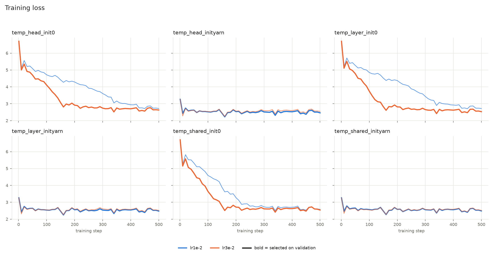
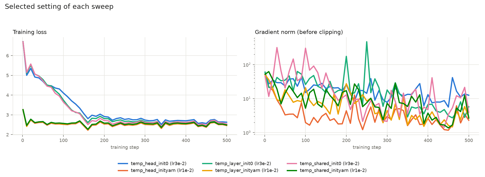

# RQ1: learned frequencies + temperature (overnight run, 2026-11-12)

**Setup.** Frozen OLMo-2-1B; only positional parameters trained (`learned_freq_temp`, AdaScale
temperature). 3 granularities (shared / layer / head) × start (`a = 0` or YaRN, incl. YaRN's
attention scaling) × lr {1e-2, 3e-2} = 12 runs: 500 steps, one 16k PG-19 sequence per step
(100 sequences), AdamW, constant lr, seed 0. Each sweep's lr picked by **validation PPL at 16k**;
winners and 4 training-free baselines evaluated on test.
Test sets: PG-19 test PPL (50 sequences per length), passkey (150 prompts, seed 1), RULER
(8 NIAH tasks, 500 samples per task and length). Run with `scripts/scc/pipeline.sh`.

## Test results

| Model | LR | PPL 4k / 8k / 16k | Passkey all (16k)* | RULER avg (4k / 8k / 16k) |
|---|---|---|---|---|
| head, YaRN init | 1e-2 | 17.01 / **17.41** / **15.09** | 0.73 (0.18) | **61.95** (69.8 / **62.9** / **53.1**) |
| layer, YaRN init | 1e-2 | 17.19 / 17.65 / 15.31 | 0.68 (0.08) | 48.09 (58.6 / 50.1 / 35.6) |
| shared, YaRN init | 1e-2 | 17.32 / 17.76 / 15.43 | 0.88 (0.72) | 48.86 (61.4 / 49.0 / 36.2) |
| layer, init 0 | 3e-2 | 17.90 / 18.43 / 16.05 | 0.61 (0.00) | 45.65 (59.9 / 43.7 / 33.3) |
| shared, init 0 | 3e-2 | 18.10 / 18.68 / 16.23 | **0.95 (0.96)** | 48.96 (61.0 / 49.1 / 36.8) |
| head, init 0 | 3e-2 | 18.73 / 19.40 / 17.20 | 0.49 (0.00) | 17.25 (24.5 / 21.3 / 5.9) |
| YaRN, tuned | — | 19.95 / 22.87 / 21.38 | 0.68 (0.46) | 35.01 (45.7 / 35.4 / 24.0) |
| YaRN, default | — | 27.11 / 40.14 / 41.67 | 0.37 (0.00) | 5.39 (8.3 / 6.6 / 1.2) |
| PI ×4 | — | 109.1 / 118.6 / 110.9 | 0.00 (0.00) | 0.00 (0.0 / 0.0 / 0.0) |
| stock OLMo-2 | — | **16.41** / 124.6 / 430.3 | 0.33 (0.00) | 24.28 (**72.8** / 0.0 / 0.0) |

*Passkey numbers use only 150 prompts; 750-prompt re-tests are queued.

## Train and validation (all 12 runs)

Train loss = mean of the last 50 steps (nats). Validation = PG-19 validation PPL, passkey (150 prompts, seed 0).

| Granularity | Start | LR | Train loss | Val PPL 4k / 8k / 16k | Val passkey | Selected |
|---|---|---|---|---|---|---|
| head | 0 | 1e-2 | 2.784 | 17.15 / 15.88 / 16.79 | 0.49 | |
| head | 0 | 3e-2 | 2.682 | 17.60 / 15.67 / 15.56 | 0.47 | ✓ |
| head | YaRN | 1e-2 | 2.534 | 15.87 / 14.09 / **13.68** | 0.71 | ✓ |
| head | YaRN | 3e-2 | 2.606 | 17.00 / 15.08 / 14.65 | 0.64 | |
| layer | 0 | 1e-2 | 2.784 | 17.60 / 15.85 / 16.71 | 0.47 | |
| layer | 0 | 3e-2 | 2.602 | 16.71 / 14.85 / 14.51 | 0.63 | ✓ |
| layer | YaRN | 1e-2 | 2.550 | 16.03 / 14.26 / 13.87 | 0.73 | ✓ |
| layer | YaRN | 3e-2 | 2.585 | 16.52 / 14.69 / 14.34 | 0.83 | |
| shared | 0 | 1e-2 | 2.648 | 17.26 / 15.40 / 15.20 | 0.65 | |
| shared | 0 | 3e-2 | 2.629 | 16.91 / 15.07 / 14.66 | **0.94** | ✓ |
| shared | YaRN | 1e-2 | 2.562 | 16.24 / 14.39 / 13.98 | 0.89 | ✓ |
| shared | YaRN | 3e-2 | 2.583 | 16.58 / 14.70 / 14.28 | 0.84 | |
| *YaRN, tuned* | — | — | — | 18.45 / 18.03 / 18.92 | 0.73 | |

## Takeaways

- **Every learned model beats tuned YaRN on test PPL at 16k** (15.1–17.2 vs 21.4), training
  only 576–16,896 positional parameters (frequency scales + 512 temperature) for 500 steps.
- **Starting from YaRN wins at every granularity**, on validation and test PPL. It converges within
  ~20 steps; from 0, lr 3e-2 needs ~150–250 steps and lr 1e-2 is still improving at 500.
- **Per-head from YaRN is the best model overall:** RULER 62 (53 at 16k vs 24 for tuned YaRN) and
  69.8 at 4k, close to the stock model's 72.8.
- **Per-head from 0 is the weak cell** (RULER 17): 16k parameters may need more steps from scratch.
- **Passkey disagrees with RULER** (e.g. shared-from-0: 96% passkey at 16k, RULER 36.8). Passkey
  is easier and these numbers use only 150 prompts; 750-prompt re-tests are queued.
- Cost at native length: test PPL at 4k is 17.0–18.7 vs 16.4 for the stock model.

## Caveats and next

- One seed; validation and test on mixed GPUs (L40S / A40 / RTX A6000); selection on PPL only.
- YaRN-started sweeps always picked the lower lr (1e-2): the optimum may be lower (try 3e-3).
- In progress: the same sweep with PoSE (4k chunks, `length_source: positions`) and the
  750-prompt passkey re-tests.

## Seeds

Same for every run. Seeds fix which data and prompts are used, not bit-exact numbers (bf16 on GPU).

| Stage | Seed | Recorded in |
|---|---|---|
| Training data (which PG-19 chunks, and their order) | 0 | `outputs/sweeps/<sweep>/runs/<setting>/config.yaml`, `train_summary.json` |
| Validation PPL | 0 | `runs/<setting>/val_ppl.json` |
| Validation passkey | 0 | `runs/<setting>/val_passkey.json`; `plan.json` (`val_passkey_seed`) |
| Test PPL | 0 | `results/sweeps/<sweep>/test_ppl_*.json` |
| Test passkey | 1 | `results/sweeps/<sweep>/test_passkey_*.json`; `plan.json` (`test_passkey_seed`) |
| RULER test data | 42 | `results/sweeps/<sweep>/test_ruler_*.json`; per-prediction metadata in `ruler_test/` |

Validation and test PPL share seed 0 but draw from different books (separate PG-19 splits).

Reproduce (SCC login node): see README, "Overnight pipeline"; plots with
`uv run --with matplotlib python -m posext.plot_training outputs/sweeps/temp_*`.
